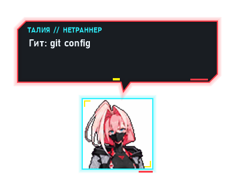
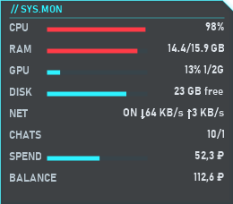
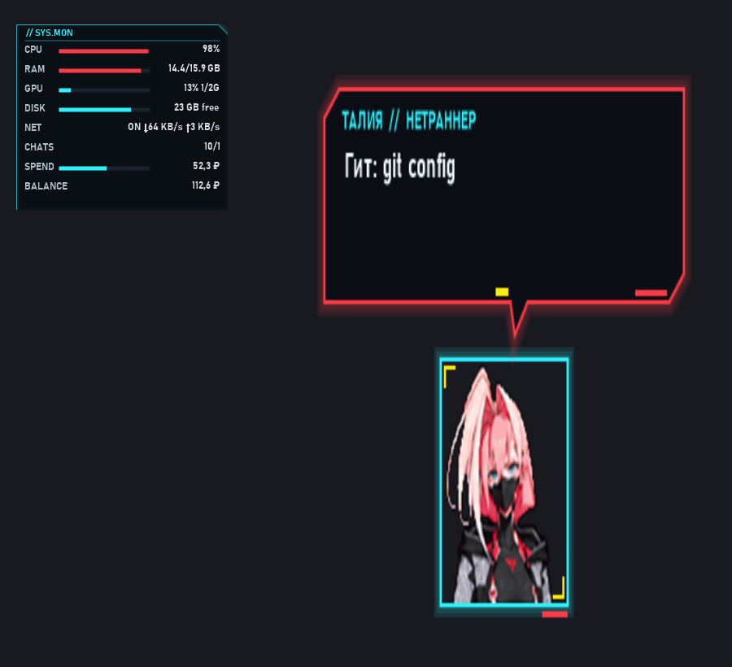
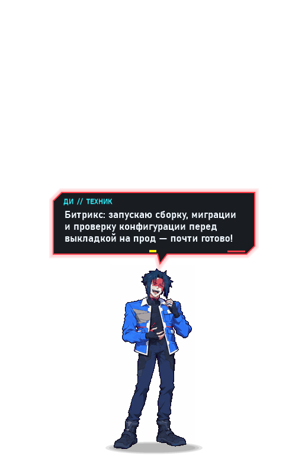
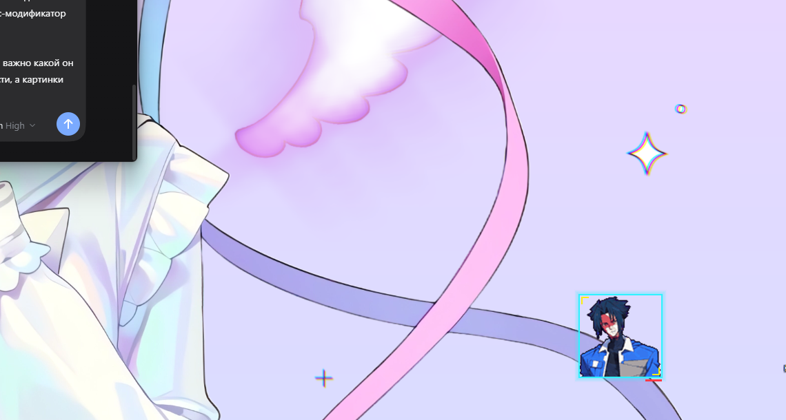

# dsh_pet_cyberpunk — киберпанк-питомец для DeepSeek Harness

Неофициальный фан-порт мода [edgerunners](https://github.com/Alexanderadon/edgerunners) (Claude Code)
на **DeepSeek Harness**. Аниме-напарник живёт на рабочем столе, реагирует на работу агента настоящими
репликами, показывает системный монитор и умеет звать вас, когда модель закончила или спрашивает.



## Что умеет

- **Четыре героя с кадрами** — Роман (оператор), Талия (нетраннер), Ди (техник), Уик (фиксер);
  плюс персонажи без кадров со своими репликами. 40+ анимаций, эффекты, переходы поз.
- **Живёт в правом нижнем углу экрана**, всегда поверх окон (`WS_EX_TOPMOST`), виден и при свёрнутом
  Harness. **Перетаскивается мышью**, позиция запоминается (`posX/posY`), в настройках есть «сбросить».
- **Реагирует на работу агента**: читает файл — читает голо-планшет, правит код — печатает, команды —
  «снимает/взламывает/чинит», ошибки — фейспалм, опасные команды — пугается, готовый ход — радость.
- **Говорит о настоящем деле**: «Читаю index.ts», «Гит: коммичу», «PHP: правлю component.php»,
  «Битрикс: смотрю template.php», «CSS: правлю style.css», «Вёрстка: смотрю page.html»,
  «Фигма: смотрю макет», «Консоль: npm run build», «План: 3 шагов, сейчас «…»».
  Служебный контекст Harness в реплики не попадает.
- **Отдыхает по-настоящему**: садится, ложится, засыпает, скучает, потягивается. Отдыхает около
  выбранного места.
- **Клик** — реакция и реплика, повторные тычки злят. **ПКМ** — меню: герой, язык (ru/en), звонок,
  громкость, размер, частота реплик, эффекты, прогулки, мини-режим, мониторинг, сброс позиции.
- **Входящий вызов/вопрос/подтверждение**: три вида карточки (зелёная — готово, жёлтая — вопрос,
  красная — подтверждение), одна кнопка «ПРИНЯТЬ» возвращает в окно Harness. Портрет — только в звонке.
- **Мини-режим**: вместо героя маленькая аватарка 120×120, реплики из неё, позиция и драг сохраняются.
- **SYS.MON** — отдельное перетаскиваемое окно монитора:
  `CPU · RAM · GPU · DISK · NET · CHATS · SPEND · BALANCE`.
  CHATS — открытые/занятые чаты; SPEND — потрачено на токены сегодня (₽ по реальному балансу аккаунта,
  курс ЦБ); BALANCE — остаток на балансе в рублях. Панель не забирает фокус и не мерцает.
- **Экономия ресурсов**: спокойная сцена ~30 к/с, активная — 60; сэмплирование только при видимой
  панели; GPU раз в 5 с. В покое ~5–7 % одного ядра, RAM ~140 МБ.
- **Не тратит токены модели**: не регистрирует инструменты, не пишет в system prompt и историю;
  `/persona` и `/report` — команды UI-плоскости. Мониторинг и файлы — локальные.
- **Сам поднимается после падения** (`pet.beat`), ведёт `pet-crash.log`, раз в час убирает старые
  временные профили headless Chrome в `%TEMP%` (чтобы диск не забивали чужие скрипты).

## Скриншоты

| | |
|---|---|
|  |  |
|  |  |

Звонки: [зелёный «готово»](docs/screenshots/call-green.png),
[жёлтый «вопрос»](docs/screenshots/call-yellow.png),
[красный «подтверждение»](docs/screenshots/call-red.png).

## Установка

Нужны **Windows 10/11** и **DeepSeek Harness** (Desktop).

1. Склонируйте репозиторий в любое место:
   ```powershell
   git clone https://github.com/nikitakostyukweb/dsh_pet_cyberpunk.git
   ```
2. В Harness откройте **Plugins** → установка бандла из локальной папки и выберите склонированную папку
   (в ней лежит `package.json` с `dsh.bundle.patch`). В списке появится «EdgeRunners companions».
3. Включите плагин. Питомец появится сам, перезапуск приложения не нужен.

Профиль «desktop» управляется приложением, поэтому установка идёт через штатный менеджер плагинов,
а не копированием файлов.

### Обновление

```powershell
git pull
```
и переключите плагин в списке (выключить → включить) — модуль перезагрузится без перезапуска приложения.

## Команды

| Команда | Что делает |
|---|---|
| `/persona` | кто сейчас на связи и список героев |
| `/persona талия` | сменить напарника: роман, талия, ди, уик, кот, мурзик, бабушка, зина, робот… |
| `/report` | отчёт героя о сессии: ходы, правки, ошибки, расход контекста |

## Несколько активных чатов

Питомец показывает **одну активную сессию** — ту, где человек написал последним (при старте — с
последней активностью). Если она простаивает, а в другом чате идёт работа, через
`activeSessionQuietSeconds` (30 с) герой переезжает туда. Вопросы/подтверждения из других чатов всё
равно показываются карточкой. `/persona` переключает питомца на текущий чат, `/report` считает по нему.

## Настройка

Параметры строки плагина (страница Plugins / `cordis.patch.yml`):

| Параметр | По умолчанию | Что делает |
|---|---|---|
| `launchPet` | `true` | запускать питомца и поднимать после падения |
| `activeSessionQuietSeconds` | `30` | через сколько секунд тишины переезжать к работающему чату |
| `completionCallAfterSeconds` | `15` | со скольки секунд работы страховочный «звонок о готовности» |
| `spendEnabled` | `true` | считать дневные траты и показывать SPEND/BALANCE |
| `spendSampleMinutes` | `5` | как часто читать баланс аккаунта |
| `rubPerCny` / `rubPerUsd` | `12.39` / `82.66` | запасной курс, если курс ЦБ не получен |
| `fetchCbrRate` | `true` | брать официальный курс ЦБ раз в день |
| `dailyBudgetRub` | `100` | дневной бюджет для шкалы SPEND |

Настройки питомца (ПКМ → шестерёнка) хранятся в `assets/pet/settings.json`: язык, размер, звонок,
громкость, реплики, эффекты, прогулки, мини-режим, монитор, позиция.

## Проверки (для разработки)

```powershell
node hooks/simulate.mjs                    # 26 проверок режиссёра, кадров и команд
powershell -File tools/verify-pet.ps1      # живой питомец: позиция, TOPMOST, pet.beat
powershell -File tools/rmb-test.ps1 [-Close]  # ПКМ-меню, отсутствие лишних PowerShell
powershell -File tools/monitor-check.ps1   # окна питомца и панели SYS.MON
powershell -File tools/desktop-snap.ps1    # снимок экрана вокруг питомца
```

## Устройство

```
index.js            Host-плагин: события Harness → режиссёр → state.json; команды /persona, /report
hooks/director.js   режиссёр: что играть, что говорить, когда спать, звонки, вопросы
hooks/mod-data.js   данные оригинала: клипы, кадры, герои, реплики, дела (esbuild-бандл)
assets/pet/         движок питомца (C#, layered-окно, 60 к/с), кадры четырёх героев
assets/popup/       карточка «вызов/вопрос/подтверждение» (call.ps1/call.cs)
tools/              диагностические скрипты
CONTRACT.md         контракт state.json и API режиссёра
```

## Лицензия и благодарности

Код, рисунки, кадры, реплики и оконный движок — из проекта
[edgerunners](https://github.com/Alexanderadon/edgerunners) (MIT, © Alexanderadon). Порт сохраняет
лицензию и указание автора, см. [LICENSE](LICENSE). Проект не связан с CD PROJEKT RED, Netflix или
Studio Trigger; товарные знаки и персонажи принадлежат их владельцам. Мод бесплатный: пользуйтесь,
меняйте и делитесь, сохраняя указание автора.

История изменений — [CHANGELOG.md](CHANGELOG.md).
